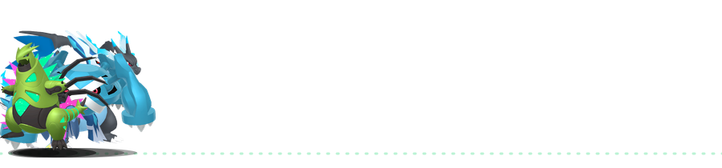

 

---

## 📌 Sobre Mim

Olá, mundo! Sou apaixonado por tecnologia e por transformar ideias em software funcional. Meu foco está no desenvolvimento **back-end** e em aplicações que integram **Inteligência Artificial**, unindo lógica, dados e automação para resolver problemas reais.

Ao longo da minha formação, participei de projetos acadêmicos e colaborativos que me ensinaram a importância de trabalhar em equipe — dividir tarefas, alinhar ideias e evoluir junto com outros desenvolvedores. Gosto de aprender novas tecnologias na prática e de aplicar o que estudo em projetos reais.

Fora do teclado, você me encontra pedalando por aí, numa quadra jogando basquete, ou imerso em algum mangá/livro da minha coleção — ou de controle na mão, jogando o que tiver na tela. 🎮📚🚴🏀

 

---

## 📊 Estatísticas do GitHub

---

## 🔤 Linguagens Mais Usadas

---

## 🧠 IDE's

---

## 🛠 Tecnologias

| Área | Stack |
| :---: | :--- |
| **🛠 Back-End** |       |
| **🎨 Front-End** |      |
| **🗄 Banco de Dados** |  |
| **🔧 Controle de Versão** |   |
| **🤖 Inteligências Artificiais** |      |

---

<!--
  ▼ REDES SOCIAIS — descomente depois de trocar os 3 valores marcados com <<< >>>
## 📺 Redes Sociais

---
-->

## 🎓 Formação

<table>
  <tr>
    <td width="50%" valign="top">
      <h3>🏫 ETEC Professor Basilides de Godoy</h3>
      <b>Ensino Técnico, Desenvolvimento de Sistemas</b> 
      📅 fev/2025 – jun/2026  
      
    </td>
    <td width="50%" valign="top">
      <h3>🎓 Universidade Cidade de São Paulo (Unicid)</h3>
      <b>Bacharelado em Engenharia de Software</b> 
      📅 Em andamento  
      
    </td>
  </tr>
</table>

---

## 🚀 Projetos

<table>
  <tr>
    <td width="33%" valign="top" align="center">
      <h3>✈️ Partiu Destino</h3>
      Plataforma de agência de viagens com app mobile, sistema web e painel administrativo.  
      
    </td>
    <td width="33%" valign="top" align="center">
      <h3>🏢 Bravyn</h3>
      Projeto empresarial.   
      
    </td>
    <td width="33%" valign="top" align="center">
      <h3>🦉 Sova</h3>
      Projeto acadêmico de desenvolvimento de software e banco de dados.  
      
    </td>
  </tr>
</table>

---

## 📜 Certificados

- 🏅 [Competências Digitais Essenciais e Inteligência Artificial para o Sucesso](https://certificados.cruzeirodosulvirtual.com.br/blackboard/certificado/998b7c9ff76da5dae91f79757c3e80f5) — Unicid
- 🏅 Fundamentos de TI: Hardware e Software — Fundação Bradesco

---

